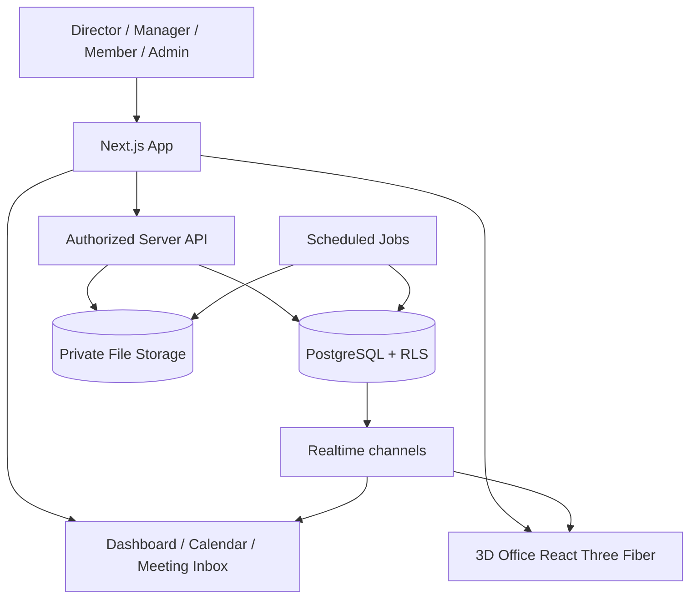

# 3D Virtual Office — Implementation Blueprint (v0.1)

> จากบทสนทนาความต้องการของเจ้าของไอเดียเมื่อ ต.ค. 2026  
> สถานะ: **แผนเริ่มพัฒนา ไม่ใช่ระบบที่สร้างเสร็จแล้ว**  
> ข้อควรระวัง: ส่วน **Confirmed** ด้านล่างสรุปจากบทสนทนา; ส่วน **Proposed Technical Design** คือข้อเสนอของผู้วิเคราะห์ ไม่ใช่สิ่งที่เจ้าของไอเดียยืนยันทั้งหมด

## 1. Product Vision — Confirmed

เว็บบริหารงานสำหรับพนักงานจริง โดยมี **ออฟฟิศ 3D เป็นหน้าหลักเชิงภาพ (visual layer)** เพื่อดูคน งาน วันหยุด สถานะ และกำหนดส่ง ไม่ใช่ระบบให้ AI Agents ทำงานแทนคน

**เป้าหมายที่ชี้วัดได้:** หัวหน้าไม่ลืมแจกงานหลังประชุม; เห็นภาระงานชัดเจน; งานและการตรวจงานมีเจ้าของและวันส่งที่ตรวจสอบย้อนหลังได้

**ผู้ใช้แรกเริ่ม:** ผู้อำนวยการ 1, Manager 1, สมาชิกประมาณ 7, Admin แยกต่างหาก; ขยายเป็นหลายทีม/หลาย Manager ได้ภายหลัง

**สภาพแวดล้อม:** เข้าเว็บผ่านอินเทอร์เน็ต ใช้ Windows และ iPhone; ภาษาไทยและอังกฤษ; timezone Asia/Bangkok; ทำงานจันทร์–เสาร์ 08:00–17:00 (ไม่นับวันอาทิตย์ วันหยุดบริษัท และวันหยุดสมาชิกในคำนวณภาระงาน)

## 2. Functional Scope — Confirmed

### 2.1 Roles, authorization, onboarding

- ผู้อำนวยการ: ภาพรวม แจกงานปกติผ่าน Manager หรือแจกงานด่วนตรงถึงสมาชิก (แจ้ง Manager อัตโนมัติ); ตรวจงานที่ Manager เป็นผู้ทำ
- Manager: ดูแลสมาชิก มอบหมายงาน ตรวจงานสมาชิก เลื่อน/โอนงาน จัดการคำขอและภาระงาน
- สมาชิก: สร้างงานของตัวเองได้ทันทีและแจ้งหัวหน้าทั้งสองระดับ; อัปเดตงาน ส่งตรวจ ขอเลื่อน; ดูงานทีมทั่วไปได้
- Admin (แยก): จัดการบัญชี/ทีม/ข้อมูล/สิทธิ์/แฟ้ม/ประวัติ/งานลับได้ทั้งหมด
- เชิญบัญชีโดย Admin เท่านั้น → ตั้งรหัส → ชื่อเล่น → แต่ง Avatar → เลือก Pet → ประเมินทักษะ → เข้า Office
- Account inactive ของผู้ลาออกยังเก็บงานและประวัติ; ไม่มี MFA ตาม requirement ปัจจุบัน (ควรประเมินความเสี่ยงใหม่ก่อนขึ้น production)
- งานลับ: คนทั่วไปเห็นได้แค่ **ชื่อหัวข้อ**; ผู้สร้าง/ผู้รับผิดชอบ/Manager/ผู้อำนวยการ/Admin เห็นรายละเอียดตามสิทธิ์

### 2.2 Work lifecycle

- ทุกคนสร้าง Task ได้; งานมีคนรับผิดชอบหลายคน/เจ้าของหลักร่วมกันได้; มีโครงการและงานย่อย
- 8 สถานะหลัก: `not_started`, `in_progress`, `blocked`, `in_review`, `revision_required`, `completed`, `paused`, `cancelled`
- ป้ายเสริมแยกจากสถานะ: งานใหม่วันนี้ / รออนุมัติเลื่อนกำหนด / รอเธอกลับมาทำงานนะ 😏
- งานสมาชิก → Manager ตรวจแล้วผ่านหรือขอแก้; งาน Manager → ผู้อำนวยการตรวจ
- Request deadline extension: สมาชิกเสนอกำหนดใหม่และเหตุผล → Manager อนุมัติ/ปฏิเสธ; งาน Manager ส่งให้ผู้อำนวยการ; งานด่วนแจ้งผู้อำนวยการเมื่อเปลี่ยน; ระหว่างพิจารณาพักการเตือนชั่วคราว
- เมื่ออนุมัติงานเสร็จจะถูก Archive ทันที; Archive อ่าน/ดาวน์โหลดได้อย่างเดียว ไม่เปิดกลับไปแก้
- Audit log ทุกการเปลี่ยนสำคัญ; ไฟล์เวอร์ชันล่าสุดแสดงผู้มีสิทธิ์ทั่วไปและเวอร์ชันเก่า Admin ดูได้
- งานระบุประเภท (แก้ไขได้โดยผู้มีสิทธิ์), ขนาด, ชั่วโมงประมาณการ, ความสำคัญ 3 ระดับ, checklist, tag, due datetime, ไฟล์, comments/@mentions, recurrence
- ไม่ต้องเก็บ % ความคืบหน้าและชั่วโมงที่ใช้จริง

### 2.3 Meeting → Unassigned Work Inbox (หัวใจผลิตภัณฑ์)

- Manager/ผู้อำนวยการสร้างบันทึกการประชุม; สมาชิกที่ไปประชุมแทนเพิ่มสรุปได้
- บันทึกชื่อ วันเวลา ผู้เข้าประชุม สรุปแบบวางข้อความ ไฟล์แนบ และ action items
- Action item ที่ยังไม่ถูกแจกอยู่ใน Unassigned Inbox แม้ยังไม่มีเจ้าของงาน
- เริ่มนับเวลาจาก **เวลาสิ้นสุดประชุม**; เตือนทุก 24 ชั่วโมงจนกว่า action items ทั้งหมดจะถูกแจก; แสดงจำนวนที่คงค้าง
- Manager/ผู้อำนวยการเลือกเจ้าของงานด้วยตนเอง; ระบบแนะนำแบบ **กติกา (rule-based)** จากจำนวนงาน ขนาด ชั่วโมงโดยประมาณ ความถนัด วันหยุด และกำหนดส่ง; คนตัดสินใจสุดท้ายเสมอ
- AI สกัดงานจากบันทึกการประชุมเตรียมจุดเชื่อมต่อไว้ แต่ **ไม่ต้องทำ AI รุ่นแรก**

### 2.4 Calendar, leaves, reminders

- มุมมอง Today/Week/Month/My Calendar/Team Calendar พร้อมกรองคน/หมวดงาน
- สมาชิกบันทึกวันหยุดล่วงหน้า หลายวัน/ครึ่งวัน โดยไม่ต้องขออนุมัติ
- คนอื่นเห็นสถานะการไม่อยู่; เหตุผลเห็นเฉพาะเจ้าตัว Manager ผู้อำนวยการ Admin
- งานชนวันหยุด → แจ้ง Manager เพื่อพิจารณาเลื่อน/โอนเอง ไม่เปลี่ยนเจ้าของหรือกำหนดส่งอัตโนมัติ
- เตือนงานก่อนครบกำหนดทุกวันตั้งแต่เหลือ 7 วัน โดยบางงานปรับกติกาได้; ผู้รับงานทุกคน/Manager/ผู้อำนวยการได้รับการเตือน
- แจ้งเตือนใน Web App เท่านั้นขณะเปิดเว็บ; เมื่อกลับมาเปิดเว็บต้องเห็นแจ้งเตือนค้างอ่าน; Realtime เมื่อมีการเปลี่ยน

### 2.5 3D world, avatars, pets, ephemeral chat

- Cute Low-poly Hybrid / Future Office / กล้องหมุน-ซูม-ลากได้; ทำ 3D ทั้ง Windows และ iPhone
- ห้องผู้อำนวยการ, โต๊ะ Manager, โต๊ะสมาชิกพร้อมจอสองจอ/มุมสัตว์เลี้ยง, ห้องประชุม, พักผ่อน/เกม, กระดานงานรอแจก, บ้านสำหรับคนหยุด
- คลิกตัวละคร → ชื่อ/ตำแหน่ง/งานที่กำลังทำ/จำนวนและขนาดงาน/งานใกล้ส่ง/ปฏิทิน/สถานะไม่อยู่ (แสดงข้อมูลตามสิทธิ์)
- ตัวละครย้ายตำแหน่งตามสถานะทำงาน ประชุม นอกสถานที่ อยู่บ้าน
- แต่ง Avatar: ผิว หน้า ตา จมูก ปาก ผม เสื้อ กางเกง/กระโปรง รองเท้า แว่น อุปกรณ์; เลือกได้ทั้งหมดตั้งแต่เริ่ม
- Pet: หมา/แมว เลือกสายพันธุ์ สี ชุด ชื่อ มีเสียง (ปิดได้); ตามสเปกล่าสุด Pet ส่งสัญญาณแจ้งเตือนเฉพาะเมื่อถูก @mention
- แชทรวมห้องเดียว มุมขวาล่าง แสดงชื่อหรือ anonymous; Admin ตรวจสอบตัวตนผู้ส่งได้; ข้อความ/รูป/GIF/sticker/emoji, เอฟเฟกต์ลอยในฉาก; ปิดเสียง/ซ่อนได้; **ลบข้อความถาวรเมื่อครบ 24 ชั่วโมง**

### 2.6 Dashboard, search, files

- หน้าแรกแยกบทบาท; รายงานกราฟงานแยกสถานะ/ประเภท/คน, ตรงเวลาหรือช้า, ชั่วโมงประมาณการ, งานรอตรวจ/แก้ไข
- ทุกคนดูสถิติผลงานบุคคลได้; ตารางอันดับสมาชิกเฉพาะ Admin
- เลือกช่วงเวลา, ค้นหาข้อมูลและกรองหลายเงื่อนไข; Export Excel/CSV/PDF
- ไฟล์ Office/PDF/ภาพ/วิดีโอ/ZIP/ลิงก์ตามสิทธิ์และ version policy
- ตั้งค่าธีมสว่าง-มืด/ลดการเคลื่อนไหว, รองรับอนาคตหลายทีมและ Microsoft 365/Outlook (ยังไม่เชื่อม)

## 3. Proposed Technical Design — ไม่ใช่ Requirement ที่ยืนยันจากพี่

| Concern | Recommended implementation | เหตุผล |
|---|---|---|
| Web + UI | Next.js + TypeScript + Tailwind CSS + shadcn/ui | Dashboard และ route แบบเว็บแอป |
| 3D | Three.js + React Three Fiber + Drei | สร้าง Office scene ที่เชื่อม React state ได้ |
| Assets | Blender → GLB/glTF, shared rig, interchangeable meshes/materials | แต่งตัวละคร/สัตว์เลี้ยงได้โดยไม่สร้างโมเดลทุก combination |
| Data | Supabase PostgreSQL | relation หลายตาราง, transaction, SQL report |
| Login | Supabase Auth (email/password + admin invitation) | Invite-only onboarding |
| Access control | PostgreSQL RLS + server-side authorization | ปกป้องรายละเอียดงานลับ ไม่เชื่อแค่การซ่อน UI |
| Files | Supabase Storage private buckets | แยกเอกสาร/ไฟล์ส่วนตัว/สื่อแชท |
| Live updates | Supabase Realtime Broadcast/Presence and selected Postgres Changes | Task status + online state + chat |
| Timed work | Supabase Cron + server-side job/functions | เตือนงานรอแจก, แจ้งเตือน, purge แชท/ไฟล์ |
| Hosting | Vercel (web) + Supabase (data) | แยกเว็บ/DB ชัดเจน |
| Monitoring | Server logs, error tracking, Cron execution logs, daily backup policy | ตรวจงานล้มเหลวและกู้คืน |

**Architectural principle:** PostgreSQL เป็นแหล่งความจริงของงาน (source of truth); 3D เป็นเพียงการแสดงผลจากข้อมูลเดียวกันกับ Dashboard. อย่าเก็บสถานะจริงไว้เฉพาะในฉาก 3D.

### Suggested database schema (table outline)

**Identity/organization:** `organizations`, `departments`, `teams`, `team_members`, `profiles`, `role_assignments`, `member_skills`, `invites`, `working_calendars`, `company_holidays`

**Projects/tasks:** `projects`, `task_categories`, `priority_levels`, `tasks`, `task_assignees` (`is_primary`), `task_checklist_items`, `task_tags`, `task_tag_links`, `task_comments`, `task_attachments`, `task_submissions`, `task_reviews`, `task_change_requests`, `task_audit_logs`, `task_recurrence_rules`, `archives`

**Meeting & reminders:** `meetings`, `meeting_attendees`, `meeting_action_items` (assignment status independent from tasks), `member_absences`, `notifications`, `notification_preferences`, `reminder_runs`

**3D/social:** `avatar_appearance`, `pets`, `office_positions`, `presence`, `chat_messages` (`sender_id`, `is_anonymous`, `expires_at`), `chat_media`, `reaction_events`

**Control plane:** `settings`, `job_runs`, `export_jobs`, `integration_connections` (placeholder for future M365)

**Key modeling rules:**

- งานมีหลายผู้รับผิดชอบหลักได้ → relation `task_assignees`; อย่าใช้ single owner column เท่านั้น
- งานลับ: ปกปิด content/comment/file/url/search/export/realtime payload ในทุก endpoint; สมาชิกที่ไม่ได้รับอนุญาตเห็นเฉพาะหัวข้อ
- สถานะจริงใช้ enum/controlled reference; ป้าย “งานใหม่วันนี้” เป็น computed badge ไม่ใช่ state หลัก
- หลีกเลี่ยงการ hard-code Manager 1 คนใน schema เพราะต้องรองรับหลายทีมในอนาคต
- งานครบกำหนด/แจ้งเตือน/นับวันทำงานอิง timezone `Asia/Bangkok`; เก็บ timestamp ใน DB เป็น UTC
- เก็บ real user ID ของแชท anonymous สำหรับ Admin เท่านั้น โดยไม่ส่งให้ client ผู้ไม่มีสิทธิ์
- `chat_messages.expires_at` + scheduled purge สำหรับข้อความและสื่อที่อัปโหลด; ตรวจว่าข้อมูลไม่ค้างใน cache/search/exports/logs; กำหนด backup retention อย่างโปร่งใส เพราะการลบจากฐานข้อมูลไม่ได้หมายความว่าหายจากสำรองข้อมูลทันที
- การอนุมัติงาน/ย้าย archive/เปลี่ยน due date/สร้าง notification ต้องทำแบบ transaction ที่สอดคล้องกัน; เก็บ audit trails

## 4. Build Order — All in V1, but incremental delivery

> เจ้าของไอเดียต้องการทุกฟีเจอร์ในเวอร์ชันแรก ดังนั้นแผนนี้เป็น **ลำดับการลงมือพัฒนาและตรวจรับ** ไม่ใช่ข้อเสนอให้ย้ายฟีเจอร์ที่ยืนยันไป V2

### Milestone A — Project foundations
- Setup Git repository, environments, Supabase migrations, RBAC/RLS, invitation flow, initial Admin
- Data model + API + dummy data for 1 Director, 1 Manager, 7 Members
- Wireframes for Dashboard / Task details / Calendar / Meeting Inbox / 3D Office / Avatar Editor

**Acceptance:** ทุก role login ได้และเข้าถึงข้อมูลที่ตัวเองควรเห็นเท่านั้น; private task ไม่รั่วผ่าน API

### Milestone B — First end-to-end vertical slice, with 3D from the beginning
- Meeting note → unassigned items → Manager assigns one → Member sees task → Member submits → Manager approves → Archive
- 3D Office base scene with clickable desks/avatars fed by live DB state
- Live task update and basic team dashboard

**Acceptance:** เวิร์กโฟลว์จริงทำจบในเว็บ รวมถึงการคลิก Avatar ใน 3D แล้วเห็นงานตรงกับ Dashboard

### Milestone C — Work operations
- 8 task states, co-owners, subtasks, review/revisions, change requests, recurring tasks, versioned files, comments/@mentions, audit log
- Calendar, leave status, assignment rule-based scoring, due/meeting reminders and personal/team inbox
- Admin configuration and archive behavior

**Acceptance:** ผ่านกรณีงานด่วน, คนหยุดชนวันส่ง, ขอเลื่อน, หัวหน้าตรวจกลับแก้, งานลับ

### Milestone D — Full 3D & gamification
- Future-office rooms/locations, animated state, mobile performance, low-motion option
- Full modular Avatar customization, Dog/Cat customization and effects
- Chat room + anonymous mode + 24h deletion and media cleanup + reaction effects

**Acceptance:** ทำ onboarding/แต่งตัว/เปลี่ยนสถานะ/แชทได้บน Windows และ iPhone จริง โดยไม่มีข้อมูลจากงานลับรั่วใน 3D

### Milestone E — Reporting & production readiness
- Dashboard ทุก role, exports Excel/CSV/PDF, search, advanced filters, dark/light theme, TH/EN
- Performance testing on iPhone, role-based security tests, backup/restore test, monitoring and operation runbooks
- Conduct pilot with the actual team before wider deployment

**Acceptance:** หัวหน้ารู้ว่า action items ไหนยังไม่แจก, คนไหนรับงานอะไร, ขนาดงานและวันส่ง; สมาชิกเห็นงานของตัวเองและแจ้งเตือนตรงเวลา

## 5. Critical QA scenarios

1. **Forgotten meeting task:** meeting ends 15:00 with three action items, only one gets assigned → after 24h Inbox still shows two unassigned with reminder; reminders continue each 24h until all are assigned.
2. **Urgent direct task:** Director assigns a member directly → Manager notified; Member gets task immediately; Manager can adjust priority/deadline and Director notified.
3. **Leave collision:** member marks leave covering due date → Manager sees conflict and decides reschedule/reassign; no automatic mutation.
4. **Private task:** unrelated member can see only task title; API responses, attachments, search, exports, realtime, 3D popovers never disclose detail.
5. **Review and archive:** Member submits, Manager rejects with reason, Member resubmits, Manager approves, task becomes immutable archive.
6. **Extension pending:** Member asks for due-date extension → pending label, reminders temporarily paused; approval/rejection restores proper schedule and audit.
7. **Anonymous chat:** normal members cannot identify sender; Admin can; all chat content and uploaded media reach the configured deletion process after 24h and are absent from app after expiry.
8. **Cross-device:** Windows Chrome/Edge and iPhone Safari show same owner, task state, presence and schedule; 3D camera controls work on touch and mouse.
9. **No fake AI:** assignment suggestions show explicit weighted-rule explanations; never claim machine learning unless implemented and validated.

## 6. Practical next actions

1. Confirm this blueprint against the original requirement and mark any discrepancies (particularly security, retention, production readiness).
2. Draw actual screen flows and UI wireframes: Meeting Inbox, Task Creation, Review, Team Dashboard, 3D Office, Avatar Editor.
3. Specify schema + permission matrix + migration scripts; seed synthetic users and tasks. Never develop first against real confidential employee records.
4. Implement Milestone B as first vertical slice and demo it with real interactions, not static mockups.
5. Continue through all V1 commitments using tests and reviews at each milestone.

**Future only:** AI meeting-summary action extraction, advanced AI assignment recommendation, Microsoft 365 / Outlook integrations.
